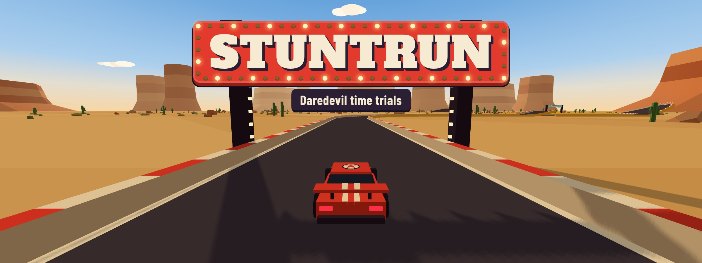
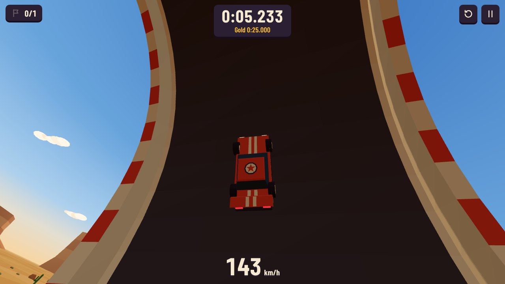
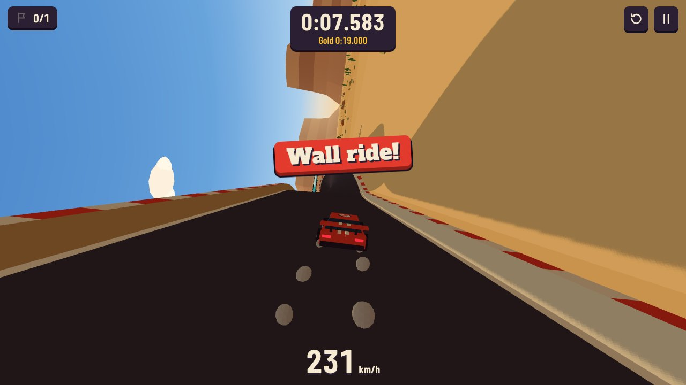
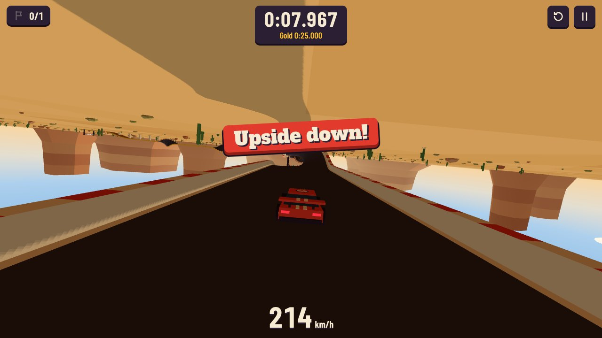
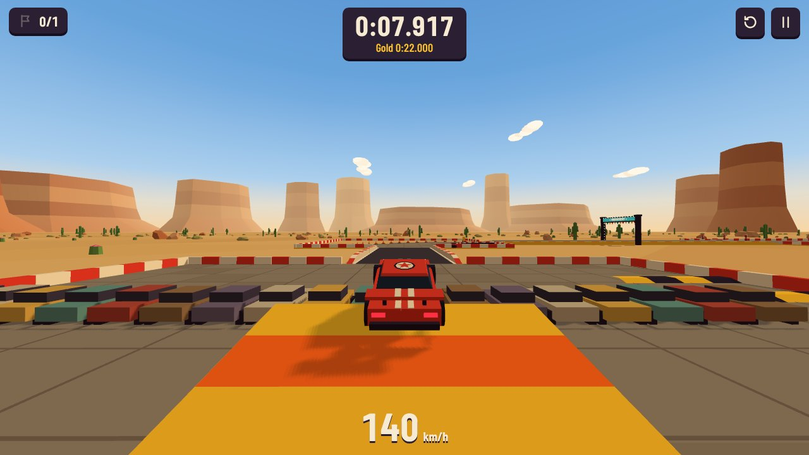
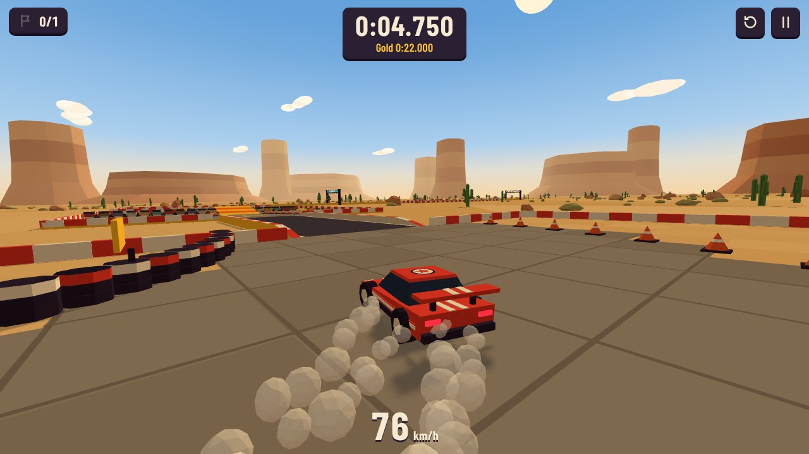
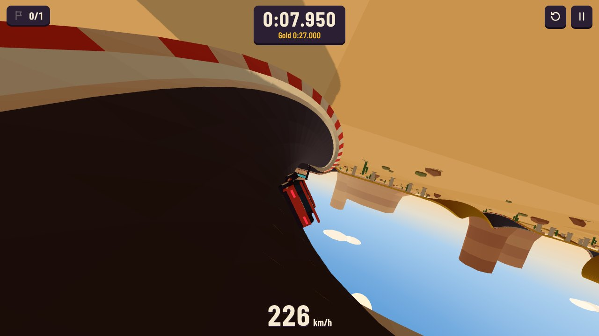
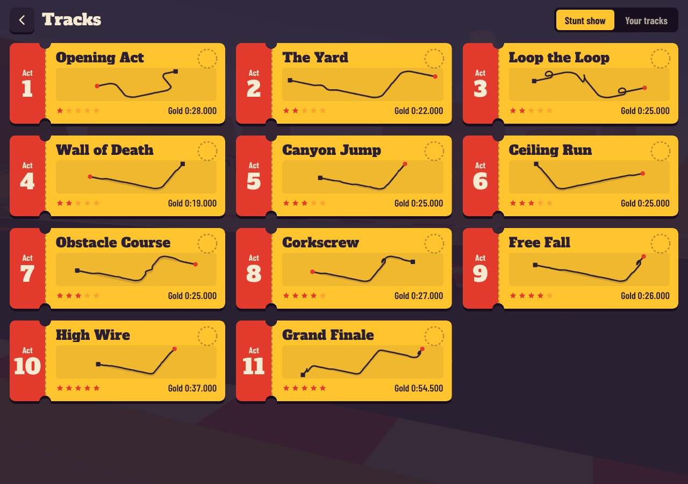
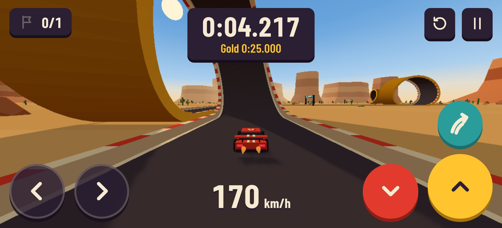
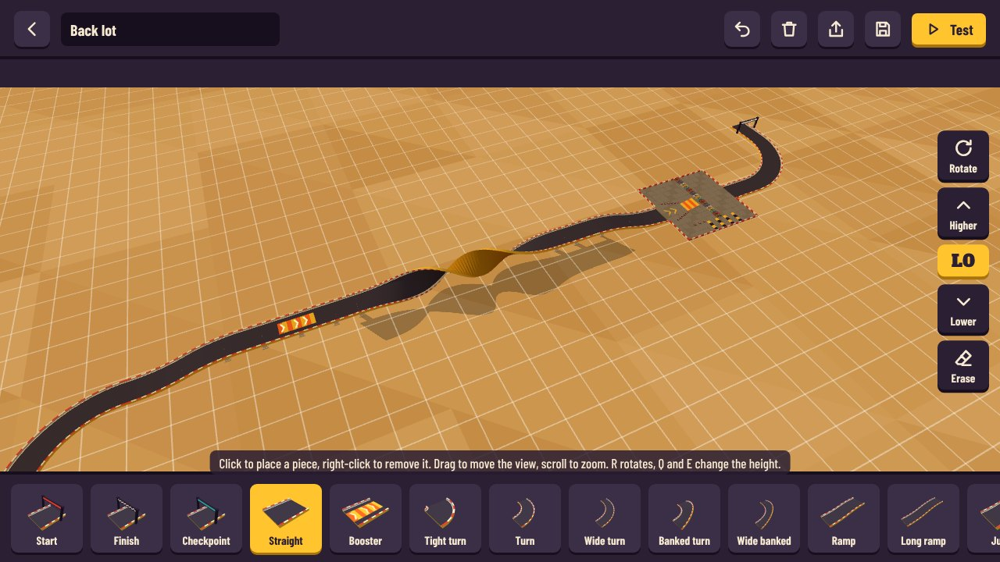

<p align="center">
  <a href="https://gorzaweba.github.io/Stuntrun/"></a>
</p>

<p align="center">
  <b>A low-poly 3D stunt racing game, set at a travelling stunt show in the desert.</b><br>
  Ride walls, drive upside down, loop the loop and jump the wrecks, against the clock and your own ghost.<br>
  It runs in the browser on desktop and on phones. Nothing to install, no build step.
</p>

<p align="center">
  <a href="https://gorzaweba.github.io/Stuntrun/"></a><br>
  <sub><a href="https://gorzaweba.github.io/Stuntrun/">gorzaweba.github.io/Stuntrun</a></sub>
</p>

<p align="center">
  <a href="#the-stunts">The stunts</a> &nbsp;&nbsp;|&nbsp;&nbsp;
  <a href="#the-running-order">The running order</a> &nbsp;&nbsp;|&nbsp;&nbsp;
  <a href="#controls">Controls</a> &nbsp;&nbsp;|&nbsp;&nbsp;
  <a href="#track-editor">Track editor</a> &nbsp;&nbsp;|&nbsp;&nbsp;
  <a href="#run-it-yourself">Run it yourself</a>
</p>


## The stunts

<table>
  <tr>
    <td width="33%" valign="top"><br><b>Loop the loop.</b> Above about 85 km/h the tyres stick all the way round.</td>
    <td width="33%" valign="top"><br><b>Wall of death.</b> Ride a vertical wall at full speed. Slow down and gravity wins.</td>
    <td width="33%" valign="top"><br><b>Ceiling run.</b> Sixty metres upside down. Hit the booster first.</td>
  </tr>
  <tr>
    <td width="33%" valign="top"><br><b>Jump the wrecks.</b> Cones line you up, the ramp does the rest. Or take the bumpy chicken lane.</td>
    <td width="33%" valign="top"><br><b>Drift.</b> Hold the drift button and the back steps out. Counter-steer to hold the angle.</td>
    <td width="33%" valign="top"><br><b>Corkscrew.</b> A full 360° roll, taken flat out.</td>
  </tr>
</table>

## The running order



Eleven acts, from a gentle opener to the full show. Each one has gold, silver and bronze times to beat.

| Act | Track | What's on | Difficulty | Gold |
| :---: | --- | --- | --- | ---: |
| 1 | **Opening Act** | Wide sweepers you can take flat out, two kickers and the first wreck jump | ★☆☆☆☆ | 0:28.000 |
| 2 | **The Yard** | Every arena in one yard: the tyre-wall corner, the wreck jump, the chicane | ★★☆☆☆ | 0:22.000 |
| 3 | **Loop the Loop** | Three boosted loops linked by wide turns | ★★☆☆☆ | 0:25.000 |
| 4 | **Wall of Death** | Two wall rides and a wall turn | ★★☆☆☆ | 0:19.000 |
| 5 | **Canyon Jump** | Three big jumps into landing arenas | ★★★☆☆ | 0:25.000 |
| 6 | **Ceiling Run** | Two upside-down runs with a corkscrew between them | ★★★☆☆ | 0:25.000 |
| 7 | **Obstacle Course** | The arenas back to back, up on stilts | ★★★☆☆ | 0:25.000 |
| 8 | **Corkscrew** | Two corkscrews, a loop and two wall turns | ★★★★☆ | 0:27.000 |
| 9 | **Free Fall** | Loop, wall turn, wall ride and ceiling, then the wreck jump | ★★★★☆ | 0:26.000 |
| 10 | **High Wire** | Four levels up, and you never touch the ground | ★★★★★ | 0:37.000 |
| 11 | **Grand Finale** | The whole show in one lap | ★★★★★ | 0:54.500 |


## What's in the show

### Driving

- **Weighty car physics.** A 1350 kg raycast-suspension car with real body roll and weight transfer. Its tyres break into a slide when you push too hard, and they grip less until the slide settles. It's slow to change direction at speed, so brake before corners, or hold drift to swing the back round.
- **Drift button.** Hold it to kick the back out and slide through corners. See [Drifting](#controls) below.
- **Stunt grip.** On walls, ceilings, loops and rolls the tyres grip harder the faster you go. Above about 90 km/h the car sticks, so you can ride vertical walls and drive upside down. Below about 65 km/h gravity wins and you drop off. In the air the nose follows the flight path, so landings stay clean.
- **Checkpoints and respawn.** Press <kbd>R</kbd> (or ↺) to go back to the last checkpoint: you start again standing still, upright and facing down the track, so nothing from a crash carries over. Press it twice quickly to restart the run from the start.
- **Ghost replays.** Your best run is saved and races alongside you as a translucent car.

### The course

- **Stunt pieces.** Loops, corkscrews (a full 360° roll), upside-down sections, wall rides, near-vertical wall turns, small and big jumps, ramps, banked turns and boost pads.
- **Stunt arenas.** Fenced open floors, each built around one idea, where you pick your own line:
  - *Jump arena:* cones line you up on a ramp over a row of wrecked cars, or you take the bumpy chicken lane round the side.
  - *Chicane arena:* two staggered walls with arrow boards pointing at the gaps, and 3-2-1 brake boards before the first wall. Cutting close to the wall tips is the fast line.
  - *Turn arena:* a wide corner round a tyre-wall infield, with a sand trap on the outside if you run wide.
  - *Landing arena:* a painted landing zone after a big jump, with cones guiding you to the exit.
- **Tracks built for a heavy car.** Every corner is picked for the speed you arrive with, so you only need to brake hard where brake boards tell you to.
- **Knock-over cones.** Clip a cone and it goes flying. It costs you a little speed, not your run.

### The show

- **Stunt callouts.** "Big air", "Drift", "Wall ride!" and "Upside down!" stamp onto the screen as you pull them off.
- **Effects.** Tyre smoke when you slide, dust on the sand, a dust ring when you land a jump, sparks when you scrape a wall and confetti cannons at the finish.
- **Its own look.** A desert stunt show: striped mesas, saguaros, show gates with painted signs, marquee bulbs and bunting, and a car in show livery. The menus use marquee signs, tickets and prize rosettes. Everything is flat-shaded low poly with real-time shadows. The palette, type and rules are written down in [DESIGN.md](DESIGN.md).
- **Procedural audio, no sound files.** A six-cylinder engine with automatic gear shifts, a rev limiter, turbo whistle, blow-off and exhaust pops when you lift off. Tyre squeal follows how much the tyres are sliding, and there's road rumble, grass, wind, landing thuds and crash sounds. A generated soundtrack plays calm on the menus and full drums in races, with its own key and tempo per track. Reverb and a master compressor keep the mix together.

### On your phone



- **Mobile ready.** On-screen touch controls with multi-touch, layouts for landscape and portrait, fullscreen and installable as a home-screen app.
- **Settings:** graphics (auto, low, medium, high), separate on/off and volume for sound effects and music, km/h or mph, three camera views and eight car colours.


## Controls

| Action | Keyboard | Touch | Gamepad |
| --- | --- | --- | --- |
| Accelerate | <kbd>W</kbd> / <kbd>↑</kbd> | ▲ (right) | RT / A |
| Brake / reverse | <kbd>S</kbd> / <kbd>↓</kbd> | ▼ (right) | LT / B |
| Drift (hold) | <kbd>Space</kbd> / <kbd>Shift</kbd> | Drift button above ▲ (it accelerates too) | X |
| Steer | <kbd>A</kbd> <kbd>D</kbd> / <kbd>←</kbd> <kbd>→</kbd> | ◀ ▶ (left) | Left stick / D-pad |
| Back to last checkpoint | <kbd>R</kbd> (or <kbd>Enter</kbd>) | ↺ button | Y / Back |
| Restart from the start | <kbd>R</kbd> twice quickly | ↺ twice quickly (or Pause → Restart) | Back twice |
| Pause | <kbd>Esc</kbd> / <kbd>P</kbd> | ❚❚ button | Start |
| Change camera | <kbd>C</kbd> | Settings | LB / RB |

You can steer a little while the car is in the air.

> [!TIP]
> **Drifting:** hold drift and steer into a corner. The back of the car steps out and holds a slide of about 40°. Steer the other way to trim the angle, and keep the gas on to carry your speed. Let go and the car straightens up. A drift takes a much tighter line than grip alone, for some speed, so it's the quick way round corners that would otherwise need hard braking. It only works on the ground, never on walls, loops or ceilings.

## Track editor



Place, rotate, stack and erase pieces on a grid, test-drive the track straight away, save it on your device and share it with a link or a code.

| Action | Desktop | Touch |
| --- | --- | --- |
| Place piece | Left click | Tap |
| Erase piece | Right click, or <kbd>X</kbd> for erase mode | Erase button, then tap |
| Rotate piece | <kbd>R</kbd> | Rotate button |
| Build height | <kbd>E</kbd> / <kbd>Q</kbd> (or <kbd>PageUp</kbd> / <kbd>PageDown</kbd>) | Up / Down buttons |
| Move view | Drag, or <kbd>W</kbd><kbd>A</kbd><kbd>S</kbd><kbd>D</kbd> / arrows | Drag |
| Zoom | Mouse wheel | Pinch |
| Turn view | <kbd>Z</kbd> / <kbd>C</kbd>, or right-drag | Two-finger twist |
| Undo / Save / Test | <kbd>Ctrl</kbd>+<kbd>Z</kbd> / <kbd>Ctrl</kbd>+<kbd>S</kbd> / <kbd>T</kbd> | Toolbar buttons |
| Pick piece | <kbd>1</kbd>–<kbd>9</kbd> | Palette |

Every track needs one **Start** and at least one **Finish**. To finish, you have to drive through every **Checkpoint**, in any order.

| Group | Pieces |
| --- | --- |
| Basics | Start, Finish, Checkpoint, Straight, Booster |
| Turns | Tight turn (1×1), Turn (2×2), Wide turn (3×3), Banked turn (2×2), Wide banked turn (3×3) |
| Height | Ramp (+1 level over 2 tiles), Long ramp (+2 levels over 3 tiles). Rotated by 180° they work as downhills. |
| Air | Jump (small kicker), Big jump (2-tile kicker that launches you far) |
| Stunts | Loop left / right, Wall turn (2×2), Wide wall turn (3×3), Wall ride left / right (6 tiles), Corkscrew (360° roll, 7 tiles), Upside down (8 tiles, about 60 m driven on the ceiling) |
| Arenas | Jump arena (3×3), Chicane arena (3×5), Turn arena (3×3, rotate for a right turn), Landing arena (3×4). Fenced set pieces with their obstacles already laid out around a racing line. |
| Signs | Brake board 3, 2 and 1: straights with countdown boards. Put them in that order before a corner that needs braking. |
| Open floor | Open floor, Pillar, Barrier, Cone lane, Speed bumps, Jump wedge. These are 1×1 floor tiles with no barriers that join on all four sides, so you can lay out your own open areas. |

> [!NOTE]
> Wall turns, wall rides, corkscrews and upside-down sections roll the road around the car, so they need room below. Build them at least **2 levels up** (use ▲ in the editor). They need speed: arrive fast, or you'll fall off.

**Sharing tracks:** the editor's *Share* button creates a link like `https://<your-user>.github.io/<repo-name>/#track=…`. Opening that link loads the track straight into a race and saves it under *My tracks*.


## Run it yourself

### On GitHub Pages

The game is plain HTML, CSS and JavaScript modules, and three.js is vendored in `vendor/`. GitHub Pages can serve the repository without any build:

1. Push this repository to GitHub.
2. Open the repository's **Settings → Pages**.
3. Under **Build and deployment**, choose **Source: Deploy from a branch**.
4. Pick the branch that holds the game, for example `main`, and the folder **/ (root)**, then click **Save**.
5. After a minute the game is live at `https://<your-user>.github.io/<repo-name>/`.

The empty `.nojekyll` file tells Pages to serve the files exactly as they are.

**On a phone:** open the Pages URL, tap the fullscreen button on the menu or use *Add to Home Screen*, and turn the phone sideways.

### Locally

> [!IMPORTANT]
> Browsers don't load JavaScript modules from `file://` URLs, so the folder needs to be served over HTTP.

```bash
# any static server works, for example:
python3 -m http.server 8080
# or
npx serve .
```

Then open <http://localhost:8080>.

### Testing the tracks

`tools/simulate.mjs` drives every campaign track with the built-in autopilot, using the same physics as the game but without a browser. It checks that each track can be finished, including restarting from a standstill at every checkpoint:

```bash
npm test                                   # all campaign tracks
node tools/simulate.mjs --styles           # also drive cautiously and aggressively
node tools/simulate.mjs topsy-turvy --verbose
node tools/simulate.mjs --medals           # suggested medal times
node tools/simulate.mjs "--script=U2 S*2 B S CS S*2 D2 S F"   # try a track script
node tools/map.mjs grand-stunt             # ASCII top-down map of a track
```

Node 18 or newer is needed. There are no npm dependencies.

### Adding campaign tracks

Campaign tracks are written in a small "turtle" script in `js/tracks.js`. Each token places a piece where the previous one ended. For example, `S*2 U2 S*2 B S INV S*2 D2 S F` gives: two straights, a long ramp up two levels, two straights, a booster, a straight, an upside-down section, two straights, a long ramp back down, a straight and the finish.

<details>
<summary><b>All script tokens</b></summary>

| Token | Piece |
| --- | --- |
| `S` `C` `B` `F` | straight, checkpoint, booster, finish |
| `L1` `L2` `L3` / `R1` `R2` `R3` | tight / normal / wide turn, left or right |
| `BL2` `BR2` `BL3` `BR3` | banked turns |
| `U` `D` / `U2` `D2` | ramp up/down one level, or long ramp two levels |
| `K` / `BK` | jump kicker / big jump |
| `G` | gap: skip one tile, for example after a kicker |
| `OL` `OR` | loop that exits one lane left or right |
| `WL2` `WR2` `WL3` `WR3` | wall turns (need level 2 or higher) |
| `VL` `VR` | wall ride on the left / right wall (needs level 2 or higher) |
| `CS` | corkscrew (needs level 2 or higher) |
| `INV` | upside-down section (needs level 2 or higher) |
| `P` `PL` `PR` | open floor; `PL` / `PR` turn the route left / right inside the open area |
| `PB` `PJ` `PC` `PWL` `PWR` `PP` | open floor with speed bumps / jump wedge / cones / barrier on the left / barrier on the right / pillar |
| `X/n` | widen with open floor to `n` tiles, for example `PB/5` |
| `AJ` `AC` `ATL` `ATR` `AL` | jump arena, chicane arena, turn arena left / right, landing arena |
| `BRK` | three brake-board straights (3, 2, 1) |
| `<X` `>>X` | place a piece 1 tile left / 2 tiles right of the previous one without moving on, for example `<<PP` |
| `X*n` | repeat a token, for example `S*4` |

</details>

Design rules from building the campaign (the full list is at the top of `js/tracks.js`):

- **Pick the corner for the arrival speed.** Flat out on a straight is about 190 km/h. The fastest you can hold through each corner is roughly: tight turn 85 km/h, turn 125, wide turn 150, wide banked turn 165, turn arena 135. After a long straight, use wide or banked turns. Save normal turns for after something slow.
- **Signpost real braking.** Braking from 190 to 125 km/h takes about 40 m, two tiles. Where a corner needs that, put `BRK` in front of it.
- **Give stunts a straight run-in.** Upside-down sections need at least 115 km/h, so put a booster before them. Never put a corkscrew straight out of a turn.
- **Give jumps a landing zone.** Use a landing arena (`AL`) after big jumps. Don't put a checkpoint where cars are still in the air.
- **Open floor needs a reason.** Use the arenas rather than scattering obstacle tiles.

After adding a track:

```bash
npm test                          # can every track be finished?
node tools/lint.mjs               # does any corner ask for too much braking for its act?
node tools/simulate.mjs --medals  # medal times
node tools/handling.mjs           # re-measure the car's limits after a physics change
```

<details>
<summary><b>Project structure</b></summary>

```
index.html            page shell, menus and HUD markup
css/style.css         UI styling, responsive and touch layouts
js/main.js            game bootstrap, state machine, menus, HUD
js/car.js             vehicle physics (suspension rays, tyres, adhesion, drift, collisions)
js/collision.js       triangle spatial hash: ray casts and sphere contacts
js/pieces.js          procedural track pieces (geometry, connectors, cells)
js/track.js           track builder, route finder, turtle scripts, share codes
js/tracks.js          campaign tracks and medal times
js/race.js            race rules: timer, checkpoints, finish, respawn, cones
js/editor.js          track editor
js/arenas.js          fenced stunt arenas (jump, chicane, turn, landing)
js/scenery.js         sky, lights, desert ground, mesas, cacti, clouds
js/carModel.js        low-poly car mesh and livery
js/signs.js           painted gate signs (canvas textures)
js/fx.js              smoke, dust, sparks and confetti
js/ui.js              marquee bulbs, ticket route maps, rosettes, stars
js/camera.js          chase and orbit cameras
js/input.js           keyboard, touch and gamepad input
js/audio.js           WebAudio engine/tyre/impact sounds and generative music
js/ghost.js           ghost recording and playback
js/bot.js             autopilot (menu demo and track tests)
js/storage.js         localStorage helpers (best times, ghosts, tracks, settings)
tools/                simulator, track lint, handling measurements, ASCII map
vendor/               three.js r170 (MIT licence)
assets/               app icons and self-hosted fonts
docs/readme/          images for this README
DESIGN.md             art direction: palette, type, shapes, motion, world
```

Best times, ghosts, settings and your own tracks are stored in the browser's `localStorage` on each device.

</details>

## Credits

- Rendering: [three.js](https://threejs.org) (MIT licence, see `vendor/three.LICENSE`).
- Fonts: [Alfa Slab One](https://fonts.google.com/specimen/Alfa+Slab+One) and [Barlow Condensed](https://fonts.google.com/specimen/Barlow+Condensed), both under the SIL Open Font License (see `assets/fonts/`).
- All models, tracks, physics and sounds are generated in code. Apart from the fonts, the game uses no external art or audio assets.


